# Latent Cartographer

**A transformer that has only ever read `N E S W` builds a map of a maze it has never seen, tracks a Bayesian belief over where it is, and lets you redraw the whole maze from its activations.**

[](https://colab.research.google.com/github/PS12007/latent-cartographer/blob/main/notebooks/walkthrough.ipynb) [](https://github.com/PS12007/latent-cartographer/actions/workflows/tests.yml)

**[▶ Live demo](https://ps12007.github.io/latent-cartographer/)**: the model runs in your browser (plain JavaScript, no server). Walk the maze, watch its internal belief collapse onto your position, click a cell to *steer* what it believes, or press **Extract the map** to rebuild the maze from the network alone.

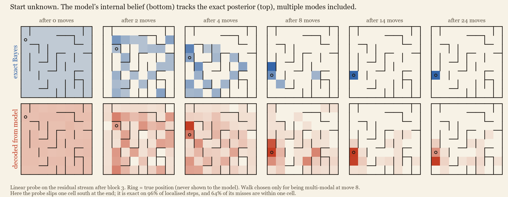

**How it localises**, as established below with probes and causal edits:

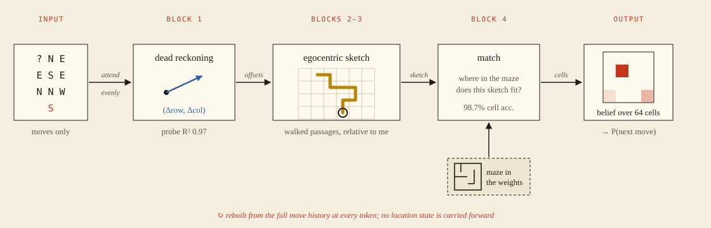

---

## The setup

* **World.** A fixed 8×8 maze with loops (randomised DFS, then 35% of the remaining walls removed). 
* **Data.** Uniform random walks of 64 moves. Each sequence starts with either `@cell` (start given, 35% of the time) or `?` (start unknown), followed by move tokens only.
* **Model.** A 0.8M-parameter GPT (4 blocks, d=128, 4 heads), trained with ordinary next-token cross-entropy for 20k steps (≈330M tokens, 7.5 min on a laptop RTX 5060).
* **Ground truth.** Because the walker picks uniformly among open directions, the best possible predictor is an **exact Bayesian filter** over the 64 cells ([`cartographer/env.py`](cartographer/env.py), checked against brute-force enumeration in the tests). This gives the exact optimal loss, *and* the exact belief state the model ought to be tracking.

The model is never told the maze, the coordinates, or that walls exist. To predict well it has to infer which moves are legal, which means knowing where it is, which needs a map nobody gave it. When the start is unknown it also has to **localise**: rule out every place it could not be, given the moves it has seen.

## Results at a glance

| | |
|---|---|
| Next-move loss vs Bayes-optimal | **0.9929 vs 0.9888 nats**. KL to optimal: 0.0001 (start given), 0.006 (start unknown) |
| Linear readout of the current cell (once localised) | **98.7%** (random-init network: 6%) |
| Linear readout of the full 64-way belief | KL **0.10** nats to the exact posterior, vs 1.64 from the model's own output distribution |
| Steering the decoded belief to another cell | model's predicted legal moves become the new cell's **90%** of the time (random edit of same size: 3.5%) |
| Maze recovered from the model by steering alone | **112 / 112 interior walls correct** |
| Writing one remembered passage into the local map | belief shifts toward whichever candidate cell has that passage (+0.22 / −0.18 vs control) |
| Replicates on 3 more mazes + a 12×12 maze | all walls recovered on every 8×8 maze; 261/264 on 12×12 |
| Place cells in the last MLP layer | 127 of 512 neurons; while uncertain they track P(cell), not the single most likely cell |
| Does a steered belief persist to the next step? | **No** (14% vs 14% unsteered): location is recomputed from the history at every token |

## 1. The model is (nearly) Bayes-optimal, and the belief is in the residual stream

Linear probes fitted at every point of the residual stream ([`experiments/probes.py`](experiments/probes.py)) show the computation unfolding with depth:

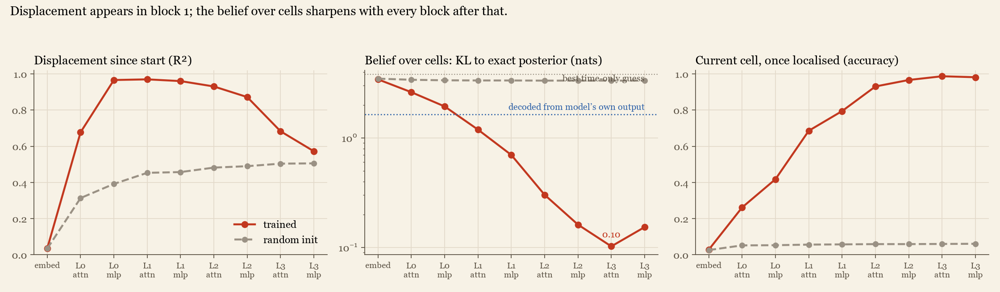

* **Dead reckoning comes first.** Displacement since the start is linearly decodable after block 1 (R² 0.97), then fades as later layers overwrite it.
* **The belief sharpens block by block.** The KL between the decoded belief and the exact posterior falls from 3.4 nats (embedding) to **0.10** (block 4 attention). It stays at 0.31 even on steps where the true posterior is still spread over several cells, so the probe recovers multi-modal beliefs, not just the most likely cell.
* **The activations hold more than the output does.** A two-layer MLP decoding the belief from the model's own next-move distribution (plus position) only reaches KL 1.64. The residual stream carries the full 64-way belief, far more than the 4 numbers it needs to emit. This matches the belief-state geometry result of [Shai et al. 2024](https://arxiv.org/abs/2405.15943), here in a spatial setting where the belief can be drawn.
* When the probe is wrong (4% of localised steps), 64% of its mistakes land **within one cell** of the truth (diagonals included). The representation is spatially smooth.

## 2. The map is causal, and you can read the whole maze out of it

Decodability is not use. To test use, [`experiments/intervene.py`](experiments/intervene.py) takes walks where the model is certain it is in cell *c*, edits the newest token's residual vector so it should mean "you are in *c′*", and checks whether the model's predicted legal moves (moves given >10%) become exactly the open sides of *c′*.

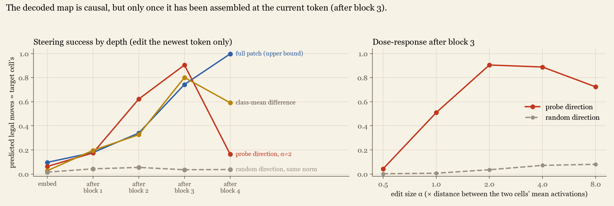

* **Probe-direction steering works.** `x + α·‖μ_c′ − μ_c‖·unit(W_c′ − W_c)`, after block 3 with α=2: **90%**. Random directions of the same norm: 3.5%. The dose-response rises and then falls as the edit overshoots.
* **The location only settles at the newest token late in the network.** Pasting in the *entire* residual vector from another walk works 10% of the time at the embedding, 34% after block 2, 74% after block 3, and 100% after block 4. Before block 3, later layers simply re-read the location from the history and overwrite the edit.
* **A negative result worth keeping.** The minimum-norm edit `W⁺(z′ − z)` that exactly swaps two of the probe's outputs *fails* (≤6%). It also pins the other 62 outputs, which drags the edit off the directions the network uses. "The probe reads X" and "this edit makes the probe read X" are different claims.

Steering to each of the 64 cells in turn and recording which moves the model then allows recovers the maze **perfectly**: every one of the 112 interior walls. The environment is never consulted.

<p align="center">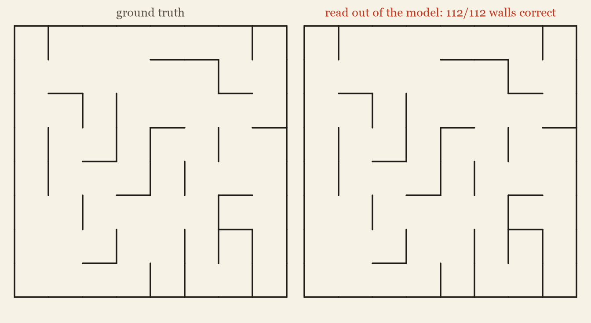</p>

**No persistence.** If the belief at step *t* is steered to *c′* and the walk then continues with a move that is legal from *c′*, the prediction at *t+1* ignores the edit completely (14% vs 14%). The network does not carry its location forward like an RNN's hidden state; it **recomputes it from the raw move history at every token**. This parallel, stateless style of computation is what one expects from a fixed-depth transformer (cf. Merrill et al., [*The Illusion of State*](https://arxiv.org/abs/2404.08819)).

## 3. How it localises: an egocentric map, matched against an allocentric one

The parallel algorithm I first expected was:
(1) each token computes its displacement;
(2) each token marks which *start* cells its own move rules out;
(3) later layers average those exclusion masks.

The data reject steps (2)–(3) ([`experiments/mechanism.py`](experiments/mechanism.py)). The single-step exclusion mask is barely decodable (balanced acc. 0.58 vs 0.51 at random init). Even an MLP probe recovers the surviving-start set only weakly (0.87 vs 0.77). The model does not reason in terms of where it began.

What it does represent is a **local map of the history, in its own coordinate frame** ([`experiments/egocentric.py`](experiments/egocentric.py)). For every offset in a 7×7 window around the current position: have I been there, and which passages next to it have I walked through?

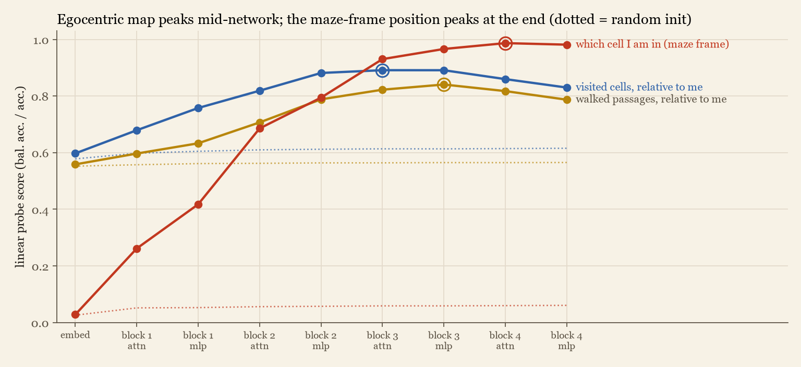

The egocentric map peaks in **block 3** (visited cells 0.89, walked passages 0.84, vs ≈0.6 at random init) and then declines. At the same time the position in the maze's own frame climbs to 98.7% in block 4. The attention pattern agrees: block 1's heads spread attention almost evenly over the whole history (normalised entropy 0.93–1.0, the averaging needed for dead reckoning), while later heads are sharp and content-dependent.

**The local map is used, not just present** ([`experiments/egocentric_causal.py`](experiments/egocentric_causal.py)). Take moments where the exact posterior has exactly two candidate cells, A (true) and B. Both fit everything seen so far; they differ only in unexplored parts of the maze. Pick a passage, relative to the walker, that has *not* been walked, and write "I walked this passage" into the residual stream after block 3 along the local-map probe's direction:

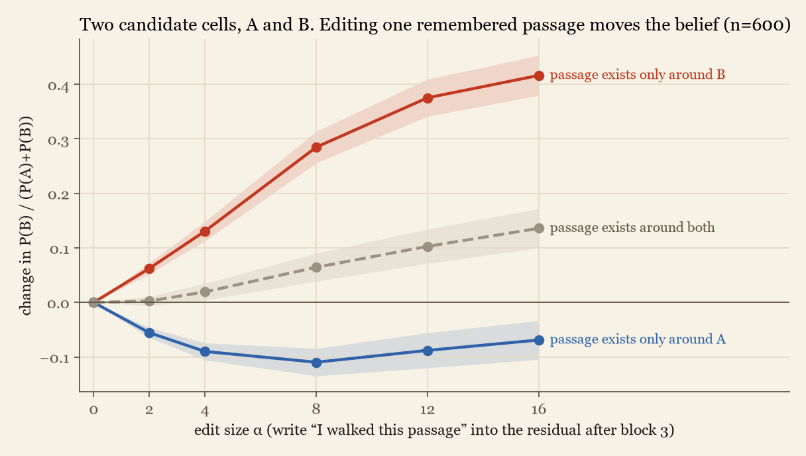

A passage that exists only around B pushes the belief toward B (+0.29 at α=8). One that exists only around A pushes it toward A (−0.11). A passage that exists around both does little (+0.07). Relative to that control the effects are +0.22 and −0.18, in opposite directions, as the matching story predicts. (The control drifts slightly toward B because the model, like the exact posterior, starts out favouring the true cell A on average, and any disruption pulls it back toward 50/50.)

**Heads divide the work** ([`experiments/head_ablation.py`](experiments/head_ablation.py)). Mean-ablating one head at a time and measuring the damage separately for known- and unknown-start walks:

<p align="center">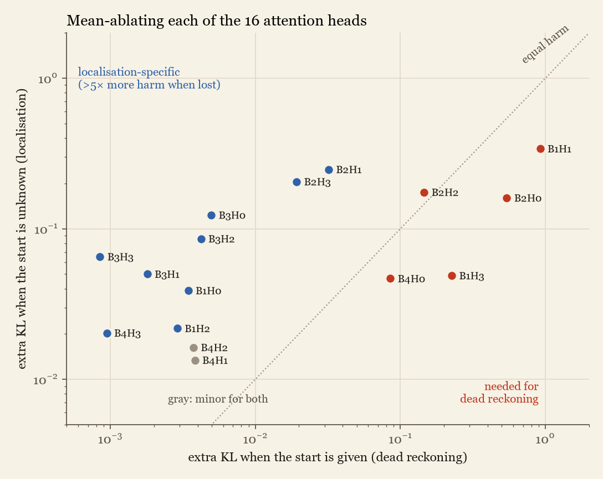</p>

* **B1H1 is the integrator.** Removing it raises known-start KL from 0.0001 to 0.92. It is also the head whose attention is almost perfectly uniform over the history (normalised entropy 0.999), exactly the averaging dead reckoning needs.
* **B1H3 reads the start token.** It gives position 0 the most attention of any head, and removing it hurts known-start walks most.
* **Nine heads are localisation specialists**, costing 7–80× more when the start is unknown. The ones that matter most are B2H1, B2H3 and all four heads of block 3, the same depth where the egocentric sketch peaks.

The emerging picture is a tiny, learned form of the SLAM that robots use: integrate your moves → build a local map of what you have walked, *relative to yourself* → match it against a map stored *in the weights* → read off where you are.

## 4. The shape of the map

Average the model's activations over every moment it is sure it is in cell *c*, giving 64 points, one per cell. Then compare distances between those points with distances in the maze ([`experiments/geometry.py`](experiments/geometry.py)):

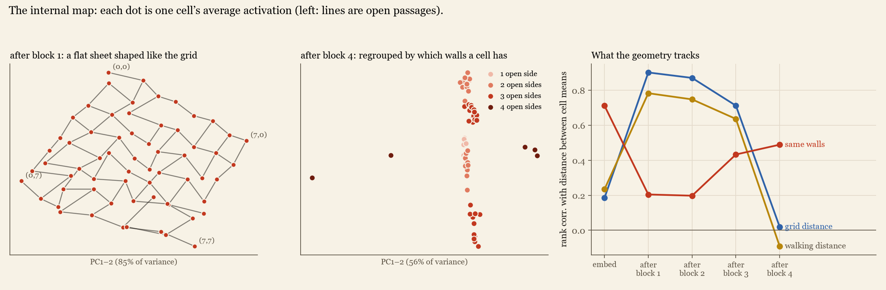

* **After block 1 the map is literally a map.** Two principal components explain 85% of the variance across cells, and plotting them redraws the maze as a slightly rotated sheet with corners in the right places. Distances between cells match grid distance (rank correlation 0.90).
* **It is a coordinate map, not a corridor map.** Walking distance adds nothing once grid distance is known (partial correlation 0.01), while grid distance adds plenty once walking distance is known (0.72). That is what dead reckoning predicts: positions are coordinates, not hops along a graph.
* **By the last block, geometry follows what each cell lets you do.** The grid structure is gone (0.02), and cells cluster by their walls (0.49): dead ends with dead ends, corridors with corridors. That is the format the output layer needs to pick a legal move.

**Place cells that encode probability** ([`experiments/place_cells.py`](experiments/place_cells.py)). Individual MLP neurons become location-selective with depth: 0 of 512 in block 1, 1 in block 2, 18 in block 3, and **127 of 512 in block 4**. Each fires for one compact patch of the maze, and its cell explains far more of its activity than that cell's wall pattern does, much like hippocampal place cells.

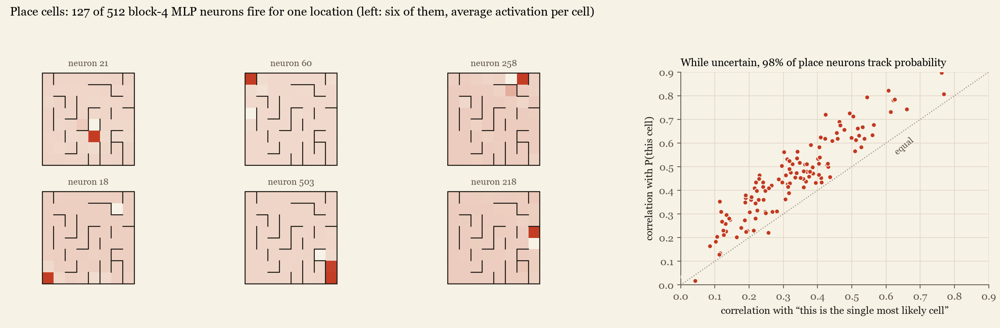

The interesting part is what they do when the model is unsure. On moments with several candidate cells, a place neuron's activity follows the *posterior probability* of its cell (mean r = 0.45) better than whether its cell is the single most likely one (r = 0.33) or whether the walker is really there (r = 0.24). That holds for 98% of them. The network does not commit to a best guess and then encode it; it keeps a graded, probability-weighted code over places. This is the "probabilistic population code" proposed for Bayesian inference in the brain.

## 5. Depth and training dynamics

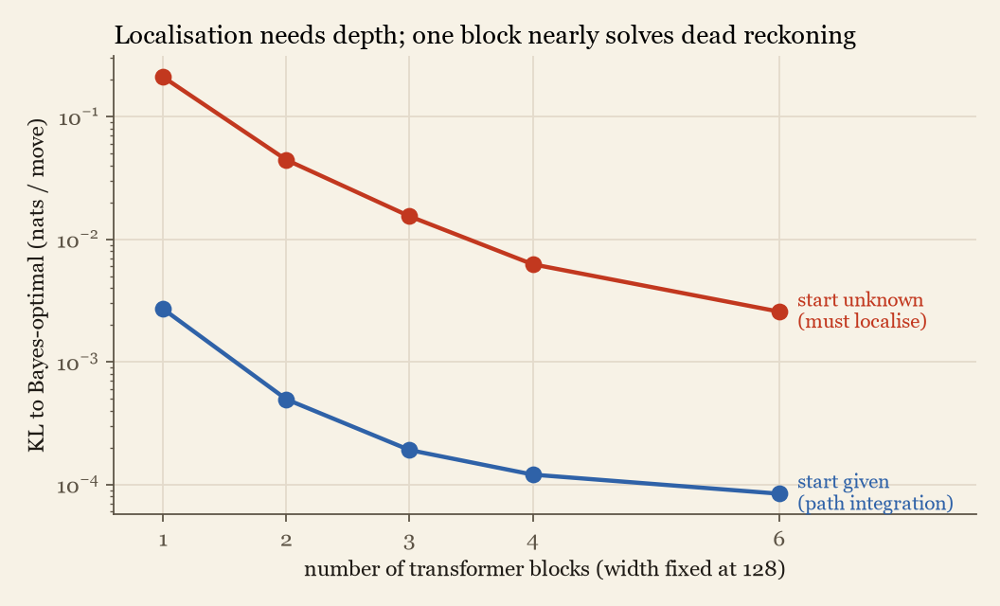

With width and training budget fixed, one block already does dead reckoning from a known start well (KL 0.003), but fails badly at localising from an unknown start (0.21, about 80× worse). Each extra block cuts localisation error by roughly 2–5× (0.21 → 0.044 → 0.015 → 0.006 → 0.0026 for 1/2/3/4/6 blocks), which fits a computation with several sequential stages: integrate, build the local map, match. (Deeper models also have more parameters, 0.2M → 1.2M, so this is depth *and* size.)

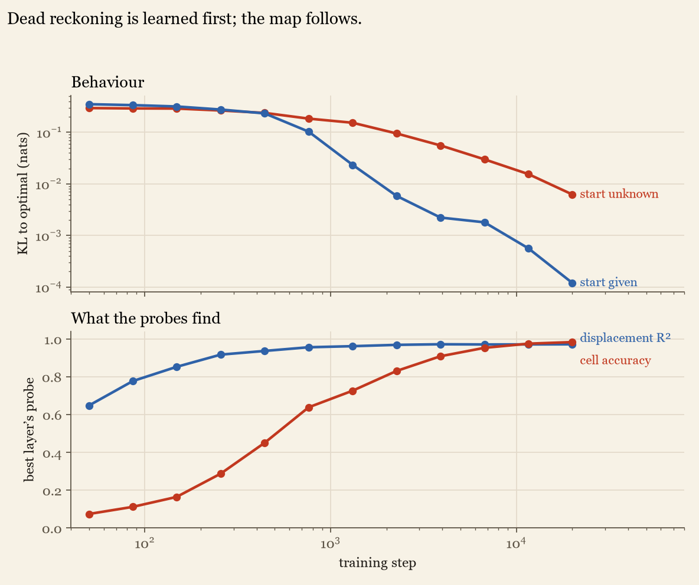

Across training, displacement becomes decodable almost at once. The maze-frame position emerges over thousands of steps afterwards, and the loss on unknown-start walks keeps improving long after known-start walks are nearly solved.

## 6. Robustness

**Other mazes, and a bigger one.** The whole pipeline was re-run from scratch (new maze *and* new initialisation) on three more 8×8 mazes, and on a 12×12 maze (144 cells, 96-move walks) with the *same* 0.8M-parameter model ([`experiments/sweep_mazes.sh`](experiments/sweep_mazes.sh), table from [`experiments/summarize.py`](experiments/summarize.py)):

| maze | KL to optimal (given / unknown start) | best probe cell acc. | steering after block 3 (random) | walls recovered | persistence (steered / not) |
|---|---|---|---|---|---|
| 8×8, seed 0 | 0.0001 / 0.0062 | 98.7% | 90% (4%) | 112/112 | 14% / 14% |
| 8×8, seed 1 | 0.0001 / 0.0054 | 98.4% | 84% (3%) | 112/112 | 14% / 14% |
| 8×8, seed 2 | 0.0001 / 0.0052 | 98.9% | 89% (3%) | 112/112 | 12% / 12% |
| 8×8, seed 3 | 0.0001 / 0.0058 | 98.1% | 82% (4%) | 112/112 | 14% / 14% |
| 12×12, seed 0 | 0.0002 / 0.0131 | 96.4% | 80% (4%) | 261/264 | 12% / 12% |

Every qualitative finding replicates: near-optimal behaviour, a linearly decodable and steerable map, perfect or near-perfect map extraction, and no persistence. On the 12×12 maze the three misses are all walls the model believes are open:

<p align="center">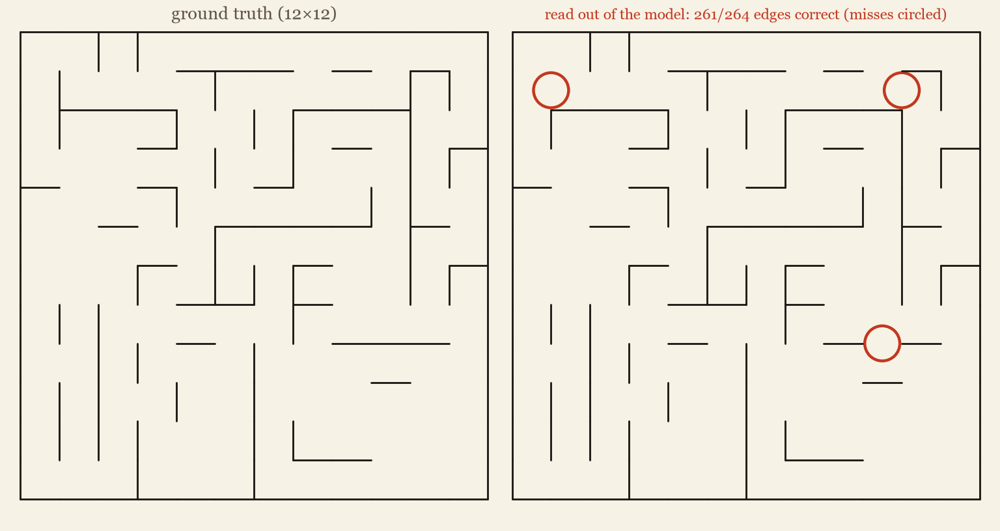</p>

**Walking styles never seen in training** ([`experiments/policy_shift.py`](experiments/policy_shift.py)). The model was trained only on uniform random walks. On walks that never backtrack, or that keep going straight 80% of the time, its predicted set of legal moves is still right:

| walk policy | start given: legal-set acc. | start unknown, once only one cell fits: legal-set acc. | …probe finds the cell |
|---|---|---|---|
| uniform | 99.7% | 98.8% | 93.7% |
| no-backtrack | 99.8% | 98.8% | 93.8% |
| momentum | 99.8% | 98.7% | 93.3% |

What the model learned is the maze, not the statistics of the walks. That is expected if localisation works by checking a sketch of walked passages against a stored map: which cells fit depends only on the walls, not on how the walker chose its moves.

**A slippery maze** ([`experiments/slippery.py`](experiments/slippery.py)). In a variant where 15% of moves silently fail (the token is emitted but the walker stays put), even a known start leaves the position uncertain. Slips spread the posterior out, and wall evidence ("that move would have been impossible from there") pulls it back in. The exact filter still applies (checked by enumerating every slip pattern in the tests). A model trained on this world gets within 0.014 nats of optimal, and its activations carry a graded belief:

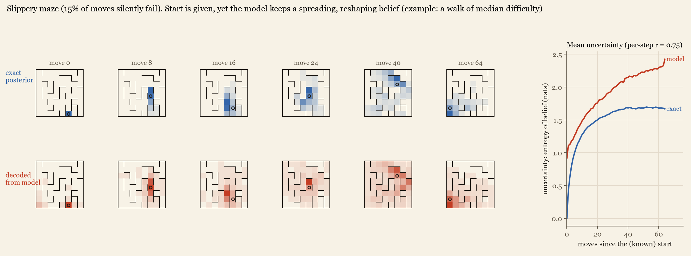

A linear probe after block 4 reaches KL 0.42 to the exact posterior, against 2.63 for the best time-only guess and 7.5 for slip-unaware dead reckoning. Its uncertainty rises and falls with the true posterior's (per-step entropy correlation 0.75). The decoded belief is consistently **more diffuse** than the truth (+0.42 nats on average). Because the model's own predictions are near-optimal, this is probably the linear probe's limit in representing sharp multi-modal beliefs rather than the model's, but a nonlinear readout would be needed to settle it.

## Reproduce

The quickest route is the [walkthrough notebook](notebooks/walkthrough.ipynb): about 15 s on a CPU, it reproduces the Bayes match, the belief probe, steering and map extraction.

```bash
pip install -r requirements.txt           # torch, numpy, matplotlib, pytest
python -m cartographer.train --out runs/main        # ~8 min on a laptop GPU (runs/main/model.pt is included)
python experiments/probes.py               # Fig. probes      -> results/probes.json
python experiments/intervene.py            # steering + map   -> results/intervene.json
python experiments/mechanism.py            # exclusion masks, attention stats
python experiments/egocentric.py           # egocentric map probes
python experiments/egocentric_causal.py    # editing one remembered passage
python experiments/head_ablation.py        # per-head mean ablations
python experiments/geometry.py             # shape of the internal map
python experiments/policy_shift.py         # walking styles never seen in training
python experiments/place_cells.py          # place cells / belief neurons
python -m cartographer.train --out runs/slip15 --slip 0.15 --p_known 0.5 && python experiments/slippery.py
bash   experiments/sweep_mazes.sh          # 3 more mazes (+ README table: python experiments/summarize.py)
python experiments/dynamics.py             # probes on training snapshots
bash   experiments/sweep_depth.sh          # depth sweep
python experiments/figures.py              # all figures
python experiments/export_web.py           # weights + probes for the demo
pytest -q tests && node tests/js_parity.mjs  # filter == brute force; JS model == PyTorch (max |Δlogit| ≈ 1e-5)
```

```
cartographer/   env.py (maze, walks, exact Bayes filter)  model.py (GPT with cache + residual hooks)
                train.py  analysis.py (ground-truth latents, probes)
experiments/    one script per experiment, each writes results/*.json
docs/           the browser demo (GitHub Pages): model.js is a line-for-line JS port of model.py
```

## Limitations and next steps

* **One architecture, small worlds.** Results replicate across 4 mazes and a 12×12 maze, but always with a 4-block, d=128 model. Depth, training dynamics and the mechanistic analyses (sections 3–5) were run on the main maze only.
* **The circuit is only partly reverse-engineered.** The stages (dead reckoning → egocentric map → matching) are established with probes and edits on the residual stream, and head ablations name the integrator and the localisation heads. But the matching step itself, where MLPs in blocks 3–4 compare the local sketch with the stored maze, has not been traced to neurons. That is the obvious next target.
* **Uniform random walks are friendly data.** [Vafa et al. 2024](https://arxiv.org/abs/2406.03689) show that transformers trained on real taxi routes predict well *without* forming a coherent map. Here the map survives biased walking policies (section 6), so the open question is what breaks it: partial observability, noisy moves, worlds too large for the model's capacity, or real trajectories.
* **Steering uses class means computed with ground-truth labels** to set the edit size. The direction comes from the probe; the scale does not.

## Related work

Li et al., [*Emergent World Representations* (Othello-GPT)](https://arxiv.org/abs/2210.13382) and Nanda et al., [*Emergent Linear Representations in World Models*](https://arxiv.org/abs/2309.00941) (board-state probing and intervention) · Shai et al., [*Transformers represent belief state geometry in their residual stream*](https://arxiv.org/abs/2405.15943) · Banino et al. 2018 and Cueva & Wei 2018 (grid-like codes from path integration in RNNs) · Whittington et al., *Relating transformers to models and neural representations of the hippocampal formation* (2022) · Vafa et al., [*Evaluating the World Model Implicit in a Generative Model*](https://arxiv.org/abs/2406.03689).

---
MIT licensed.
